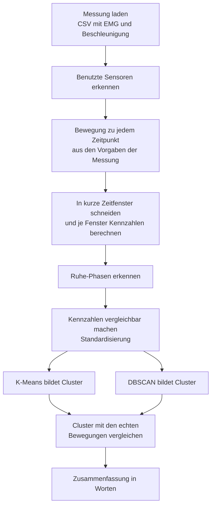

# Clustering-Analyse der EMG-Messungen

Das Notebook [`Clustering_ Analyse.ipynb`](Clustering_%20Analyse.ipynb) beantwortet eine Frage: **Lassen sich die Bewegungen einer Messung in den Sensordaten wiederfinden, ohne dass man dem Computer vorher sagt, welche Bewegung wann war?**

Wenn ja, unterscheiden sich die Bewegungen im Signal deutlich. Das ist ein gutes Zeichen dafür, dass ein später trainiertes Modell sie auch auseinanderhalten kann.

In der Webapp startet „Analysieren“ dieses Notebook für eine Messung. Das Ergebnis ist die Analyse-Seite (`<messung>.analyse.html`). Am Ende jeder Seite steht eine **Zusammenfassung in Worten**: welche Cluster gebildet wurden, welche Bewegung in welchem Cluster landet und was das bedeutet. Sie wird bei jedem Lauf aus den Ergebnissen dieser Messung neu erzeugt.

---

## Der Ablauf auf einen Blick



Jeder Schritt wird dreimal gemacht, mit drei verschiedenen Datensätzen:

| Datensatz | Inhalt | Was er zeigt |
|---|---|---|
| **nur Beschleunigung** | Bewegung der Sensoren im Raum (X, Y, Z) | Bewegungen, bei denen sich Arm oder Hand sichtbar bewegt |
| **nur EMG** | elektrische Muskelaktivität | Muskelanspannung, auch ohne sichtbare Bewegung (z. B. Faust halten) |
| **EMG und Beschleunigung zusammen** | beides | ob die Kombination mehr bringt |

---

## Die Schritte im Einzelnen

### 1. Messung laden

Jede Messung der Webapp ist eine CSV-Datei mit 2000 Zeilen pro Sekunde. Pro Sensor gibt es eine EMG-Spalte (`Emg_5`) und drei Spalten Beschleunigung (`Acc_5 :X`, `:Y`, `:Z`). Daneben liegen die **Vorgaben** (`.cues.csv`: wann welche Bewegung angesagt wurde) und das **Protokoll** (`.protocol.json`: Messplan, Impedanz-Check, Abtastrate).

In der Webapp wird genau eine Messung ausgewertet. Direkt im Notebook lassen sich auch mehrere auf einmal laden (`RECORDINGS_GLOB`), z. B. alle Messungen einer Elektroden-Platzierung. MVC-Messungen werden dabei übersprungen, weil sie nur der Kalibrierung dienen.

### 2. Benutzte Sensoren erkennen

Nicht jeder aufgenommene Sensor klebt auch am Arm. Ein Sensor wird nur ausgewertet, wenn
- er überhaupt Daten liefert (nicht nur Nullen),
- er den **Impedanz-Check** vor der Messung bestanden hat, also guten Hautkontakt hatte,
- und, falls es keinen Impedanz-Check gab, seine Muskelaktivität schwankt. Eine Elektrode in der Luft liefert gleichmäßiges Rauschen.

Alle anderen Sensoren fehlen in Auswertung und Diagrammen. Die Seite nennt sie mit Grund.

### 3. Die echte Bewegung zu jedem Zeitpunkt

Aus den Vorgaben ist bekannt, ab wann welche Bewegung galt. Weil der Mensch erst nach dem Piepton reagiert, beginnt jede Bewegung im Notebook **0,3 s später** als angesagt (`CUE_REACTION_DELAY_S`). Der Vorlauf vor der ersten Bewegung und die Pausen des Messplans zählen als **Ruhe**.

Diese „echten“ Bewegungen benutzen die Cluster-Verfahren **nicht**. Sie dienen nur am Ende zum Vergleich.

### 4. Zeitfenster und Kennzahlen

Ein einzelner Messwert sagt wenig. Deshalb wird das Signal in **Fenster von 0,1 s** geschnitten (200 Werte). Jedes Fenster überlappt zur Hälfte mit dem nächsten, so beginnt alle 0,05 s ein neues Fenster (20 pro Sekunde). Pro Fenster und Kanal werden fünf Kennzahlen berechnet:

| Kennzahl | Bedeutung |
|---|---|
| Mittelwert | wo das Signal im Schnitt liegt (bei Beschleunigung: Haltung des Arms) |
| Standardabweichung | wie stark es schwankt |
| Minimum, Maximum | die Extremwerte im Fenster |
| RMS | die „Stärke“ des Signals; beim EMG ein Maß für die Muskelanspannung |

Ein Fenster wird so zu einer Zeile mit Zahlen, z. B. bei vier Sensoren 20 Zahlen für das EMG und 60 für die Beschleunigung. Fenster, die über einen Bewegungswechsel reichen, werden weggelassen.

### 5. Ruhe-Erkennung

Auch während einer Bewegung gibt es kurze Pausen, z. B. zwischen zwei Pinches. Das Notebook teilt deshalb die Fenster jeder Messung nach ihrer Muskelaktivität in „schwach“ und „stark“. Die schwachen werden als **Ruhe** gelabelt. Ist die starke Gruppe nicht mindestens doppelt so aktiv wie die schwache (`MIN_REST_ACTIVITY_RATIO`), gilt die Messung als ohne Ruhe-Phasen. Ein Diagramm zeigt, welche Fenster als Ruhe erkannt wurden.

### 6. Vergleichbar machen (Standardisierung)

EMG-Werte liegen im Bereich von Hunderten, Beschleunigung um 1. Ohne Ausgleich würden die großen Zahlen alles bestimmen. Jede Kennzahl wird daher so umgerechnet, dass sie im Mittel 0 ist und typischerweise um ±1 schwankt.

---

## Wie Cluster gebildet werden

Ein **Cluster** ist eine Gruppe von Fenstern, deren Kennzahlen sich ähneln. Man kann sich jedes Fenster als Punkt in einem Raum vorstellen: zwei Kennzahlen ergeben eine Fläche, 80 Kennzahlen einen Raum mit 80 Richtungen. Ähnliche Fenster liegen nah beieinander. Die Verfahren suchen solche Punktwolken, **ohne die echten Bewegungen zu kennen**.

```
  Kennzahl 2                             Kennzahl 2
     ▲                                      ▲
     │   ● ●                                │   A A
     │  ● ● ●          ○ ○                  │  A A A          B B
     │   ●            ○ ○ ○        ──►      │   A            B B B
     │                 ○                    │                 B
     │        ▲ ▲                           │        C C
     │       ▲ ▲ ▲                          │       C C C
     └──────────────────► Kennzahl 1        └──────────────────► Kennzahl 1
       Fenster als Punkte                    drei gefundene Cluster
```

### K-Means

K-Means bekommt vorgegeben, **wie viele Cluster** es bilden soll. Das Notebook nimmt dafür die Anzahl der echten Bewegungen inklusive Ruhe, bei der MVC-Messung also 5. Dann:
1. Es setzt so viele Mittelpunkte zufällig in den Raum.
2. Jedes Fenster gehört zum nächstgelegenen Mittelpunkt.
3. Jeder Mittelpunkt rückt in die Mitte seiner Fenster.
4. Schritt 2 und 3 wiederholen sich, bis sich nichts mehr ändert.

Das Ganze läuft zehnmal mit verschiedenen Startpunkten, das beste Ergebnis zählt. Der Zufall ist fest eingestellt (`RANDOM_STATE = 42`), damit jeder Lauf dasselbe Ergebnis liefert.

**Stärke:** findet immer genau so viele Gruppen wie Bewegungen. **Schwäche:** teilt auch dann auf, wenn es eigentlich keine klaren Gruppen gibt, und erwartet etwa runde, ähnlich große Wolken.

### DBSCAN

DBSCAN bekommt **keine Anzahl** vorgegeben. Es sucht dicht besetzte Bereiche:
- Ein Fenster mit mindestens 10 Nachbarn in einem bestimmten Umkreis (`eps`) liegt im Inneren eines Clusters.
- Was an so ein Fenster angrenzt, gehört mit dazu. So wachsen Cluster, solange es dicht weitergeht.
- Fenster abseits von allem gelten als **Rauschen** und gehören zu keinem Cluster.

Den Umkreis `eps` bestimmt das Notebook aus den Daten selbst, an der Stelle, an der die Abstände zum zehnten Nachbarn sprunghaft größer werden („Knick“ der Kurve).

**Stärke:** findet Gruppen beliebiger Form und erkennt Ausreißer. **Schwäche:** Gehen die Bewegungen fließend ineinander über, ohne Lücken dazwischen, wird alles zu einem einzigen Cluster. Das ist bei den bisherigen Messungen meistens so.

### Darstellung über die Zeit

Mit 80 Kennzahlen kann man nicht zeichnen. Die **Hauptkomponentenanalyse (PCA)** fasst sie zu der einen Richtung zusammen, in der sich die Fenster am stärksten unterscheiden („Principal Component 1“). Die Diagramme zeigen diese Richtung über der Zeit, jeder Punkt eingefärbt nach seinem Cluster. Wechselt die Farbe zur selben Zeit wie die Bewegung, hat das Verfahren die Bewegung „gesehen“.

---

## Wie verglichen wird

Am Ende werden die gefundenen Cluster mit den echten Bewegungen verglichen.

| Maß | Frage | Werte |
|---|---|---|
| **ARI** (Adjusted Rand Index) | Liegen Fenster derselben Bewegung im selben Cluster und Fenster verschiedener Bewegungen in verschiedenen? | 1 = perfekt, 0 = wie zufällig; in der Zusammenfassung: ab 0,8 „sehr gut“, ab 0,5 „gut“, ab 0,2 „mäßig“, darunter „kaum“ |
| **NMI** (Normalized Mutual Information) | Wie viel verrät der Cluster über die Bewegung? | 1 = alles, 0 = nichts |
| **Silhouette** | Wie klar sind die Cluster voneinander getrennt, unabhängig von den Bewegungen? | 1 = sauber getrennt, 0 = überlappend, negativ = eher falsch zugeordnet |

Dazu kommen zwei Grafiken:
- **Heatmap des ARI:** alle sechs Kombinationen aus Datensatz und Verfahren auf einen Blick.
- **Cluster-Vergleich** (EMG und Beschleunigung zusammen, K-Means): eine Tabelle, wie viele Fenster jeder Bewegung in welchem Cluster gelandet sind. Steht in jeder Zeile fast alles in einer eigenen Spalte, passen Cluster und Bewegungen gut zusammen.

### Die Zusammenfassung am Ende der Seite

Sie nimmt die Kombination mit dem besten ARI und beschreibt in Worten:
- **welche Cluster** gebildet wurden: Größe, häufigste Bewegung darin, ob der Cluster eindeutig ist (mindestens 60 % aus einer Bewegung) oder gemischt,
- **wo jede Bewegung landet** und ob sie einen **eigenen Cluster** hat oder ihn sich mit anderen teilt,
- **was das heißt:** ob die Bewegungen gut, teilweise oder kaum trennbar sind und ob EMG oder Beschleunigung mehr dazu beiträgt.

Ein Beispiel aus der MVC-Messung vom 27.11.2026: K-Means auf dem EMG erreicht einen ARI von 0,93. Alle vier Anspannungen und die Ruhe haben je einen eigenen Cluster. Bei der Messung „Kontinuierlich“ (15 Bewegungen fließend hintereinander) liegt der beste ARI dagegen bei 0,26. Nur „Faust ballen“ und Ruhe haben dort einen eigenen Cluster, viele Fingerbewegungen teilen sich einen.

---

## Parametertests weiter unten

- **K-Means mit 2 bis 20 Clustern:** Für jede Anzahl wird die Silhouette berechnet. So sieht man, bei wie vielen Gruppen die Daten von sich aus am saubersten zerfallen, unabhängig von der Zahl der Bewegungen.
- **DBSCAN mit verschiedenen `eps`:** zeigt, wie empfindlich das Ergebnis auf den Umkreis reagiert (halb so groß bis doppelt so groß wie der berechnete Wert).
- **K-Means mit 8 und 9 Clustern** über die Zeit: stammt aus dem ersten Testlauf.

Die Abschnitte „Erkenntnis“ und „Samuel Teil Bericht“ sind Notizen aus dem ersten Testlauf im November 2026. Sie gelten nicht automatisch für die Messung auf der Seite.

---

## Was man beachten sollte

- **Clustering ist kein Training.** Die Verfahren kennen die Bewegungen nicht. Ein niedriger ARI heißt nur, dass sich die Bewegungen nicht von selbst als Gruppen zeigen. Ein trainiertes Modell kann sie trotzdem gut unterscheiden.
- **Die Nummern der Cluster sind willkürlich.** „Cluster 3“ hat keine Bedeutung, nur seine Zusammensetzung zählt.
- **Die Beschleunigung überwiegt im kombinierten Datensatz.** Pro Sensor gibt es 15 Kennzahlen der Beschleunigung, aber nur 5 des EMG. Bei der Faust-Messung trennt das EMG allein sehr gut (ARI 0,78), die Kombination kaum (0,00). Ist „nur EMG“ besser als „zusammen“, liegt das oft daran.
- **Kurze Pausen und Reaktionszeit verschmieren die Grenzen.** Fenster direkt nach einem Piepton gehören oft noch zur vorherigen Bewegung.
- **Eine Messung ist eine Stichprobe.** Aussagen über Probanden oder Elektroden-Platzierungen brauchen mehrere Messungen.

## Einstellungen

Alle Stellschrauben stehen als benannte Konstanten oben im Notebook (Abschnitt „Data Import“) bzw. in der Zelle, die sie benutzt, z. B. `CUE_REACTION_DELAY_S`, `MIN_REST_ACTIVITY_RATIO`, `MIN_ENVELOPE_DYNAMIC_RATIO`, `DBSCAN_MIN_SAMPLES` und die Grenzen der Zusammenfassung (`ARI_GRADES`, `CLEAR_SHARE`).
